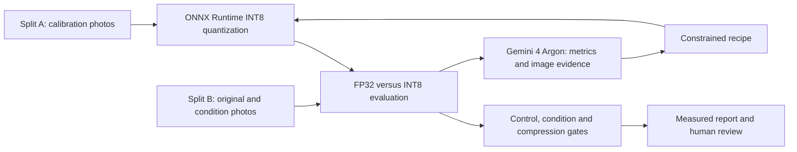

# On-Device Crash Test

A compressed detector can pass lab validation and still fail under adverse camera conditions. On-Device Crash Test compares an INT8 detector with its FP32 parent, asks Gemini 4 Argon to diagnose measured failures, and evaluates a constrained repair.

A repair is a **re-quantization recipe**: calibration composition, calibration method, per-channel granularity, or selected float exclusions. **No training.** Human review records a decision; it does not deploy a model.

## How it works



FastAPI serves the condition cards, overlays, live progress and call log. The live path uses cached condition images. Argon receives measured metrics and selected image evidence; its proposed recipe is evaluated locally rather than accepted on its own assertion.

The dataset contains 80 COCO val2017 photos with scenario classes, including people. These are not an indoor-only collection. A seeded split reserves 40 photos for calibration (A) and 40 for evaluation (B). The baseline uses the 25 brightest and sharpest Split-A photos, MinMax calibration, per-tensor quantization, stretch preprocessing, and Conv-only QDQ.

Scoring measures **agreement with the FP32 parent**, not annotated detection accuracy. References are detections that persist between the original and transformed FP32 images. FP32 retention is reported separately so a compression pass does not hide lost reference objects.

## Recorded measurements: full Split B, 40 photos

This is the recorded **classical-condition baseline checkpoint**, not a repaired run. Its clean-control raw F1 is **0.8837209302325582**. The fixed condition threshold is **0.8337209302325581** (clean-control raw F1 minus 0.05); the control sanity bar is 0.80. Decisions use unrounded values.

| Condition | Baseline F1 | Reference objects | FP32 retention | Compression result |
|---|---:|---:|---:|---|
| Night | 0.90566038 | 79 | 0.5852 | PASS |
| Glare | 0.89622642 | 113 | 0.8370 | PASS |
| Rain | 0.91071429 | 113 | 0.8370 | PASS |
| Fog | 0.80263158 | 88 | 0.6519 | FAIL |
| Occlusion | 0.93333333 | 90 | 0.6667 | PASS |
| Blur | 0.91358025 | 87 | 0.6444 | PASS |
| Smudge | 0.89090909 | 117 | 0.8667 | PASS |

Six of seven conditions pass this compression threshold. Night, fog, occlusion and blur also have informational model-limitation flags; those flags do not exempt them from compression pass/fail.

The inspected manifest records 40 classical outputs per condition for this checkpoint, including classical glare. It does not establish successful Nano Banana generation or a completed Flash audit. Any later image promotion requires new provenance and evaluation before these numbers are updated.

| Recorded baseline model measurement | INT8 | FP32 |
|---|---:|---:|
| File size, bytes | 2,788,749 | 9,804,172 |
| Median CPU latency, ms | 7.801 | 5.722 |

INT8 is 0.2844 times the FP32 file size and is slower in this CPU measurement. These are not device or NPU benchmarks. The budget is relative to baseline INT8: size and latency at most 1.10 times baseline, and quantized-op count at least 0.90 times baseline.

## Recorded live experiment: 20-photo subset

Historical run `run_44dd0ef5` evaluated 20 clean controls and 20 fog images from Split B. This is a **different scope from the 40-photo table above**. The following before/after values belong only to that same 20-photo run.

| Measurement | Before | After proposed repair |
|---|---:|---:|
| Fog agreement F1, raw | 0.7567567568 | 0.9462365591 |
| Clean-control F1, recorded display precision | 0.8806 | 0.9710 |

The recorded action combined Split-A fog calibration images with duplication weight 2, Percentile 99.999 and per-channel quantization. Argon received **16 evidence images**, used **21,063 input tokens** and **575 output tokens**, and its call took approximately **42.06 seconds**. Recorded total run time was **46.5 seconds**; a previously built candidate was reused.

That run emitted `ACCEPTED` and `done` for its target scope. **It is not evidence of a completed seven-condition zero-regression acceptance.** All-condition checks on the same subset, retention validation, and complete final-state persistence are undergoing verification. The live F1 values above were checked against captured CLI output; the linked event stream records progress, action, usage and gate details.

## Run locally

Use Python 3.12 and run from the repository root. Existing `models/`, `data/robot_vacuum/` and showcase artifacts are required to reproduce the displayed measurements.

```bash
python3.12 -m venv .venv
.venv/bin/python -m pip install -r requirements.txt
.venv/bin/python -m uvicorn app.main:app --host 127.0.0.1 --port 8080
```

Open [the local app](http://127.0.0.1:8080). A live diagnosis requires `GEMINI_API_KEY` supplied securely in the process environment; deployment should obtain it through Secret Manager. Never commit a key. To run the 20-photo fog path from the CLI:

```bash
.venv/bin/python -m odct.loop --live --conditions fog --n 20
```

Baseline preparation is available in `scripts/run_block_b.sh`; condition generation is separate. The repository includes a Dockerfile for Google Cloud Run. Earlier HTTP availability is recorded in `CHECKS.md`; it does not prove the latest deployed live flow has passed acceptance.

## Current limits and evidence

- Synthetic conditions approximate camera stress; they do not establish performance in a deployed robot.
- FP32 can fail too. Agreement, reference counts and retention must be read together.
- Calibration uses Split A; the current classical checkpoint uses related transformation families on A and B. Generator-distribution generalization is not established.
- A 16-image diagnosis is selected evidence, not a demonstrated full-context advantage. No controlled Argon-versus-fixed-policy advantage has been measured.
- Complete seven-condition repair acceptance, final-state durability and deployed live-flow acceptance remain pending in this draft. No automatic shipping is supported.
- Mock previews are illustrative and must not be reported as measurements.

Evidence: [baseline and budget](showcase/robot_vacuum/baseline.json), [40-photo condition metrics](showcase/robot_vacuum/conditions_baseline.json), [actual generation manifest](data/robot_vacuum/manifest.json), [20-photo run events](showcase/robot_vacuum/runs/run_44dd0ef5/events.jsonl), [recorded checks](CHECKS.md), and [split membership](data/robot_vacuum/splits.json).

This draft records the inspected evidence on 2026-10-16. Final numeric and acceptance claims must be refreshed after the pending validation run.
